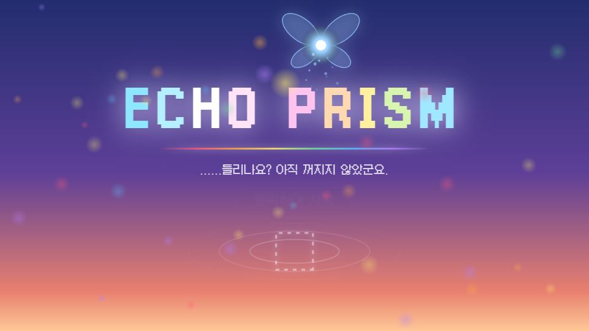
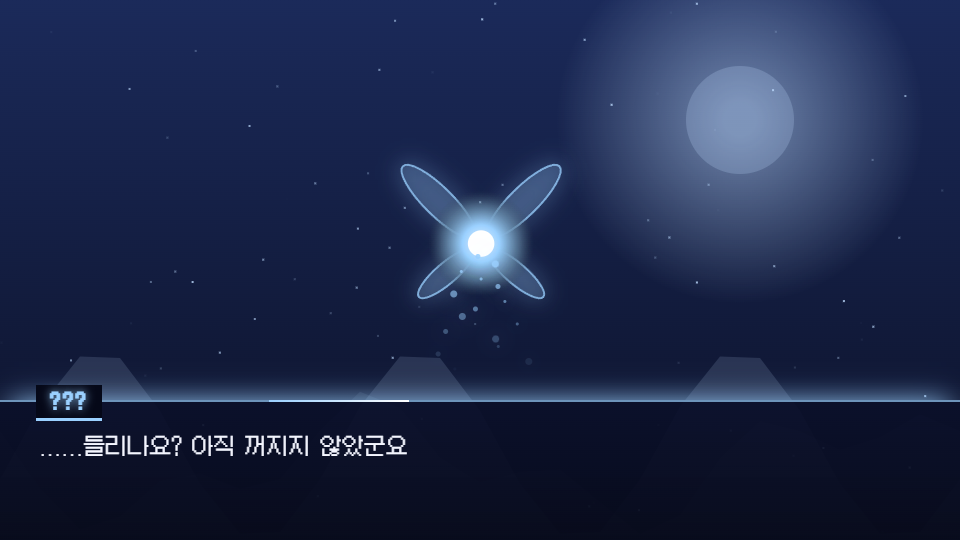

# ECHO PRISM

브라우저에서 바로 즐기는 스토리 + 탄막 슈팅 게임입니다. 설치 없이 PC와 모바일에서 플레이할 수 있습니다.

## ▶ 플레이

**https://skdyzlzl56-art.github.io/webgame/**

| 타이틀 | 플레이 화면 |
|---|---|
|  |  |

## 플레이 방법

1. 위 링크를 열고 화면을 **클릭(터치)** 하면 시작됩니다. (소리는 첫 클릭 이후에 나옵니다)
2. 대화는 **Space / Enter / Z** 또는 화면 클릭으로 넘깁니다.
3. 전투에서는 탄막을 피하며 적을 공격합니다. 체력이 다하면 클릭해서 재도전합니다.

### 조작 (PC)

| 키 | 동작 |
|---|---|
| 방향키 | 이동 |
| **X 누른 채 방향키** | 누른 방향으로 대시 (대시 중 무적, 쿨다운 후 자동 재발동) |
| Z 또는 클릭 | 사격 ON/OFF (대화 중에는 다음 대사) |
| A | 동료와 교대 (동료가 있는 전투) |
| C | 메뉴 (키 설정 · 볼륨 · 저장 · 불러오기) |
| X 누르고 있기 (대화 중) | 글자 빨리 출력 |
| Ctrl 누르고 있기 | 대화 빨리 넘기기 |

키는 메뉴의 **키 설정**에서 바꿀 수 있습니다.

### 조작 (모바일)

- 가로 화면으로 돌리면 가장 잘 보입니다.
- 왼쪽 아래 **조이스틱**: 이동
- 오른쪽 아래 버튼은 PC 키와 같습니다: **X** 대시 · **Z** 사격/확인 · **A** 교대 · **C** 메뉴 · **Ctrl** 대화 스킵 (탭하면 켜지고 다시 탭하면 꺼짐)
- 화면을 탭하면 대사를 넘기거나 사격을 켜고 끕니다.
- 대시 버튼을 누른 채 조이스틱을 움직이면 그 방향으로 대시합니다.

### 저장

메뉴(C) → 저장 / 불러오기. 대화 중에만 저장할 수 있고 전투 중에는 저장할 수 없습니다. 저장은 브라우저에 보관됩니다.

## 개발

```
npm test        # 테스트 실행
```

`webgame/index.html`을 브라우저로 열면 로컬에서도 실행됩니다. `character-voices` 브랜치에 푸시하면 GitHub Pages로 자동 배포됩니다 (`.github/workflows/pages.yml`).
